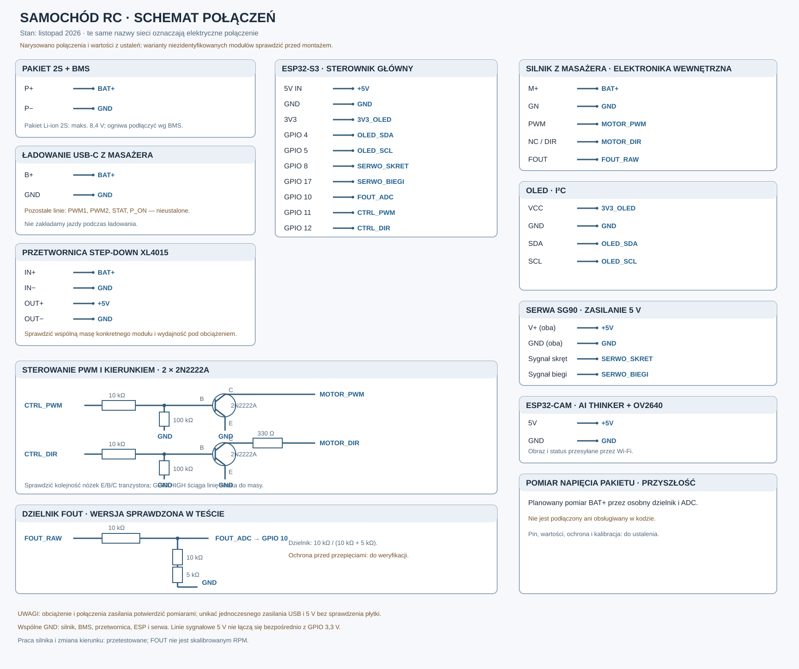

# Samochód RC LEGO Technic

Samochód LEGO Technic sterowany przez Wi‑Fi, z własnym napędem, dwubiegową skrzynią, kamerą i kokpitem w przeglądarce. Projekt służy także do nauki elektroniki, programowania ESP i rozwoju zdalnego sterowania.

## Jak to działa

- **ESP32-S3** steruje napędem i kierunkiem silnika, dwoma serwami oraz wyświetlaczem OLED. Udostępnia stronę sterowania i zgłasza stan urządzenia.
- **ESP32-CAM AI Thinker + OV2640** przesyła do przeglądarki strumień MJPEG, udostępnia zdjęcia, lampę i statystyki transmisji. Okresowo ogłasza się przez UDP; sterownik pokazuje dostępność kamery na OLED.
- **Kokpit** służy do sterowania silnikiem, skrętem, skrzynią i lampą, pokazuje obraz oraz diagnostykę. Podgląd jest pobierany z kamery bezpośrednio przez przeglądarkę.
- **Zasilanie:** nowy pakiet Li-ion 2S z BMS i płytką ładowania masażera; przetwornica XL4015 wytwarza 5 V dla odbiorników. Serwa to SG90, silnik z własną elektroniką pochodzi z masażera.

[Otwórz schemat połączeń](docs/schemat-aktualny.svg). Identyczne nazwy sieci na schemacie oznaczają połączenie. Wartości dzielnika FOUT oraz sterowania tranzystorami wynikają z przeprowadzonych testów; schemat nie zastępuje sprawdzenia faktycznego montażu i konkretnego układu ładowania.

## Struktura

- [`firmware/controller`](firmware/controller) — ESP32-S3, PlatformIO/Arduino; moduły napędu i serw, OLED, FOUT, sieci oraz API.
- [`firmware/controller/web/control.html`](firmware/controller/web/control.html) — kokpit. Skrypt kompilacji osadza go w firmware, więc zmiana strony wymaga ponownego wgrania sterownika.
- [`firmware/camera`](firmware/camera) — ESP32-CAM, podział na inicjalizację, lampę, strumień, stan i endpointy HTTP.
- [`docs/archive`](docs/archive) — poprzednie wersje schematów i historyczna roadmapa; mogą zawierać nieaktualne numery pinów.
- [`legacy`](legacy) — wcześniejsze eksperymenty: Arduino/ESP-01, aplikacja Flutter, serwer Node i projekt Visual Micro.

## Piny sterownika

| Funkcja | ESP32-S3 |
| --- | --- |
| FOUT silnika przez dzielnik 10 kΩ / 15 kΩ | GPIO 10 |
| PWM silnika przez 2N2222A | GPIO 11 |
| Kierunek silnika przez 2N2222A | GPIO 12 |
| Serwo skrętu | GPIO 8 |
| Serwo skrzyni | GPIO 17 |
| OLED SDA / SCL | GPIO 4 / GPIO 5 |

W testach wejście `NC` silnika okazało się wejściem kierunku; ściągnięcie go przez 330 Ω do GN zmienia kierunek. Prędkość jest zadawana sygnałem PWM około 7,9 kHz o aktywnym stanie LOW. FOUT reaguje na spowalnianie silnika, ale stosowana metryka przerw nie jest skalibrowanym pomiarem RPM.

## Uruchomienie i rozwój

Wymagane: VS Code z PlatformIO, narzędzia PlatformIO oraz dostęp do sieci Wi‑Fi 2,4 GHz. Projekty otwiera się **osobno**, wskazując folder `firmware/controller` lub `firmware/camera`.

1. W każdym projekcie skopiuj `include/wifi_credentials.example.h` do `include/wifi_credentials.h` i wpisz nazwę oraz hasło Wi‑Fi. Pliki z danymi są ignorowane przez Git.
2. Zbuduj i wgraj sterownik, wybierając środowisko `esp32-s3-usb` (USB) lub `esp32-s3-ota` (OTA). W `platformio.ini` ustaw właściwy adres IP; obecnie OTA jest skonfigurowane na `192.168.0.15`.
3. Zbuduj i wgraj kamerę w środowisku `esp32cam` (USB; lokalnie skonfigurowane COM3) lub `esp32cam-ota` (adres `esp32-cam-rc.local`). Numer portu może różnić się na innym komputerze.
4. Otwórz adres głównego ESP w przeglądarce. Kamera powinna zostać wykryta automatycznie; jej IP można też wpisać w ustawieniach kokpitu.

Monitor szeregowy obu modułów: **115200 baud**. Przy ESP32-CAM ustawienia `monitor_dtr = 0` i `monitor_rts = 0` pozostają w konfiguracji, ponieważ w tym zestawie były potrzebne do poprawnej pracy monitora.

Kamera pracuje obecnie w **VGA 640 × 480, JPEG 12, dwa bufory, `CAMERA_GRAB_LATEST`**. W teście użytkownika dawała około 20 kl./s; wynik i opóźnienie zależą od sceny i warunków sieciowych. Statystyki wysyłania nie mierzą pełnego opóźnienia do ekranu.

OTA i aktualne API nie mają uwierzytelniania — używać w zaufanej sieci, dopóki nie zostaną zabezpieczone. `Config.local.txt` w katalogach legacy to lokalne kopie oryginalnych ustawień, ignorowane przez Git; starsza historia Git zawiera dawne pliki konfiguracyjne i powinna zostać sprawdzona przed udostępnieniem repozytorium.

## Sterowanie

W kokpicie: strzałki ↑ / ↓ uruchamiają jazdę przód / tył, ← / → sterują skrętem, W / S zmieniają zadaną prędkość, spacja zatrzymuje napęd, L przełącza lampę. Biegi: 1 / N / 2 albo Ctrl / Shift; przy pierwszej zmianie Ctrl/Shift po otwarciu strony zadawany jest luz, ponieważ pozycja skrzyni nie jest znana. Zakres i szybkość skrętu można ustawić w kokpicie.

Sterownik zatrzymuje silnik przy braku komend; zmiana kierunku wyłącza napęd bez dodatkowego oczekiwania. Testować mechanikę na podniesionych kołach i zachować możliwość szybkiego odłączenia zasilania. Nie ma pomiaru fizycznej pozycji serw ani weryfikacji zatrzymania wału.

## Dalsze plany

- Przenieść kokpit i backend do homelabu, udostępnić je przez VPN/HTTPS i mierzyć wpływ na opóźnienie; zostawić auto-stop w ESP.
- Dodać obsługę kierownicy i pedałów przez Gamepad API, z mapowaniem i kalibracją osi.
- Rozważyć analizę obrazu na komputerze: najpierw wykrywanie trasy bez automatycznego sterowania, później autopilot i modele ML.
- Dodać pomiar napięcia pakietu i wyświetlanie przybliżonego stanu baterii; ustalić dzielnik, ADC i ochronę.
- Skalibrować FOUT pod obciążeniem; rozważyć automatyczną redukcję biegu. Dodać czujnik obrotów koła, aby sprawdzać załączenie biegu i szacować przełożenie.
- Zweryfikować wydajność zasilania pod obciążeniem i zabezpieczenie wejść oraz dopracować trwały montaż.
